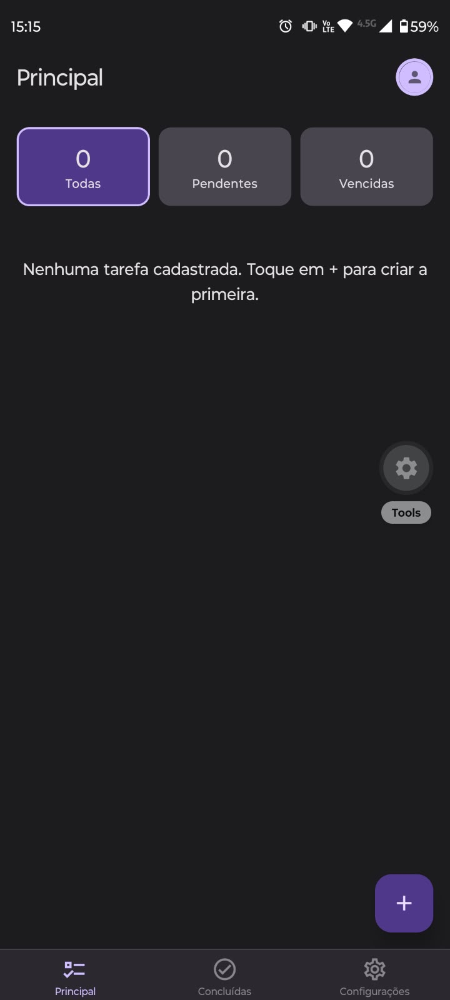
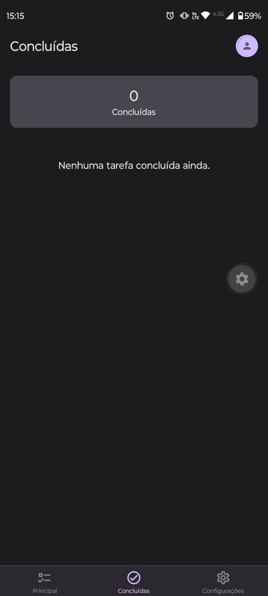
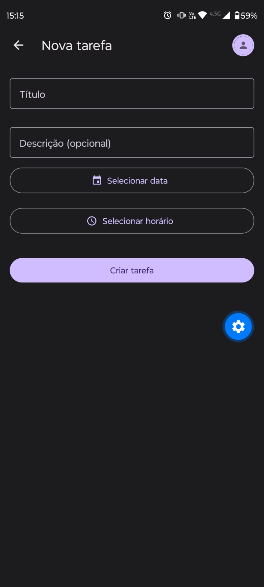
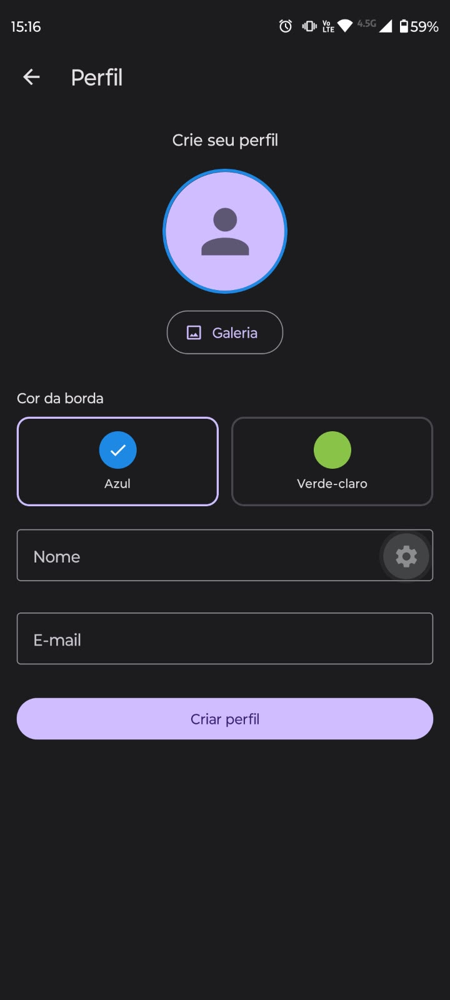
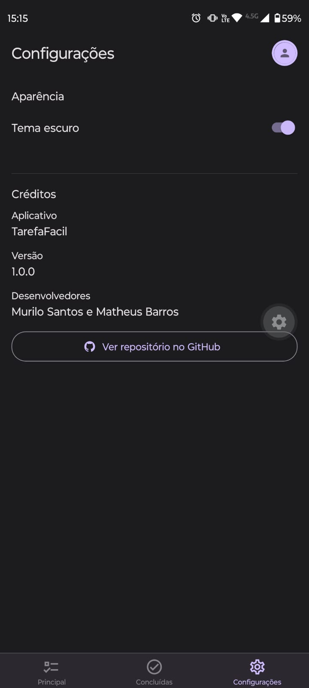

# ✅ TarefaFacil


**TarefaFacil** é um aplicativo móvel de gerenciamento de tarefas, desenvolvido como projeto acadêmico. Com ele, o usuário organiza suas atividades, define data e horário para cada uma e acompanha o que está pendente, vencido ou já concluído, tudo guardado no próprio aparelho.

A proposta é ser uma lista de tarefas simples e direta: abrir, anotar, acompanhar os prazos e marcar como feito.

## 📑 Sumário

- [Imagens do aplicativo](#-imagens-do-aplicativo)
- [Funcionalidades](#-funcionalidades)
- [Tecnologias utilizadas](#-tecnologias-utilizadas)
- [Estrutura de pastas](#-estrutura-de-pastas)
- [Demonstração do aplicativo](#-demonstração-do-aplicativo)
- [Instalação e execução](#-instalação-e-execução)
- [Desenvolvedores](#-desenvolvedores)
- [Repositório](#-repositório)

## 📱 Imagens do aplicativo

As capturas abaixo foram feitas em um celular Android, com o tema escuro ativado.

### Tela Principal

Indicadores de tarefas (Todas, Pendentes e Vencidas), que também funcionam como filtros da lista, e botão flutuante **+** para criar uma tarefa.

<p align="center">
  
</p>

### Tela Concluídas

Total de tarefas finalizadas e a listagem delas.

<p align="center">
  
</p>

### Formulário de Tarefas

Criação de uma tarefa com título, descrição opcional, data e horário. O mesmo formulário é usado na edição.

<p align="center">
  
</p>

### Perfil

Criação do perfil local, com escolha de foto pela galeria, cor da borda (azul ou verde-claro), nome e e-mail.

<p align="center">
  
</p>

### Configurações

Seção **Aparência**, com a alternância entre tema claro e escuro.

<p align="center">
  
</p>

### Créditos

A seção **Créditos** fica na parte de baixo da tela Configurações e mostra o nome do aplicativo, a versão, os desenvolvedores e o botão que abre o repositório no GitHub. Ela aparece na mesma captura da seção anterior (`public/settings.jpeg`).

> **Observação:** ainda não há capturas das telas com tarefas cadastradas, do perfil já criado (com foto) e da edição de tarefa e de perfil.

## ✨ Funcionalidades

- **Tarefas:** cadastro, edição e exclusão (com confirmação antes de excluir).
- **Prazos:** cada tarefa tem data e horário de vencimento.
- **Situação das tarefas:** pendente, vencida ou concluída, de acordo com o horário do aparelho.
- **Tela Principal:** indicadores de todas, pendentes e vencidas, que filtram a lista ao serem tocados. Também permite concluir, editar e excluir cada tarefa.
- **Tela Concluídas:** listagem das tarefas finalizadas e o total concluído.
- **Perfil local:** criação e edição com nome, e-mail (ambos validados), foto e cor da borda da foto. O avatar do cabeçalho abre o Perfil e acompanha a foto escolhida.
- **Foto de perfil:** escolhida pela galeria e copiada para o armazenamento do aplicativo, para continuar disponível depois de fechá-lo.
- **Exclusões do perfil:** *Excluir dados do usuário* (remove só o perfil e a foto) e *Excluir conta* (remove também as tarefas e a preferência de tema), cada uma com sua confirmação.
- **Temas claro e escuro:** escolhidos em Configurações e lembrados na próxima abertura.
- **Persistência local:** tarefas, perfil e tema são salvos no aparelho.
- **Créditos:** nome, versão, desenvolvedores e botão para o repositório no GitHub.

> **Ainda não implementado:** a limpeza geral dos dados locais em Configurações.

## 🛠️ Tecnologias utilizadas

| Tecnologia | Versão | Para que é usada |
| --- | --- | --- |
| [Expo](https://expo.dev/) | ~58.0.21 | Plataforma e ferramentas para desenvolver e executar o app |
| [React Native](https://reactnative.dev/) | 0.88.1 | Interface móvel nativa |
| [React](https://react.dev/) | 19.3.0 | Construção dos componentes e controle de estado |
| [TypeScript](https://www.typescriptlang.org/) | ~6.0.3 | Tipagem estática do código |
| [React Navigation](https://reactnavigation.org/) | ^7 | Navegação por abas (Bottom Tabs) e pilha de telas (Native Stack) |
| [React Native Paper](https://callstack.github.io/react-native-paper/) | ^5.15.3 | Componentes visuais e temas claro e escuro |
| [Expo Vector Icons](https://docs.expo.dev/guides/icons/) | ^15.1.1 | Ícones |
| [AsyncStorage](https://react-native-async-storage.github.io/async-storage/) | 2.2.0 | Armazenamento local de tarefas, perfil e tema |
| [Expo Image Picker](https://docs.expo.dev/versions/latest/sdk/imagepicker/) | ~58.0.10 | Escolha da foto de perfil na galeria |
| [Expo File System](https://docs.expo.dev/versions/latest/sdk/filesystem/) | ~58.0.13 | Cópia da foto para o armazenamento do app |
| [DateTimePicker](https://github.com/react-native-datetimepicker/datetimepicker) | 9.2.1 | Seleção de data e horário das tarefas |

Também fazem parte do projeto `expo-font`, `expo-status-bar`, `react-native-safe-area-context` e `react-native-screens`, usados como apoio à interface e à navegação.

## 📂 Estrutura de pastas

```text
TarefaFacil/
├── public/                      # Capturas de tela e vídeo demonstrativo
│   ├── home.jpeg
│   ├── completedTask.jpeg
│   ├── newTaskForm.jpeg
│   ├── Profile.jpeg
│   ├── settings.jpeg
│   └── TarefaFacil.mp4
├── app/                         # Projeto Expo (código-fonte do aplicativo)
│   ├── assets/                  # Ícones e imagens do app
│   ├── src/
│   │   ├── components/          # Componentes reutilizáveis
│   │   ├── context/             # Estados compartilhados (perfil e tema)
│   │   ├── hooks/               # Hooks personalizados
│   │   ├── navigation/          # Rotas e navegadores
│   │   ├── screens/             # Telas do aplicativo
│   │   ├── services/            # Leitura e gravação de dados
│   │   ├── theme/               # Temas claro e escuro
│   │   ├── types/               # Tipos TypeScript
│   │   └── utils/               # Funções auxiliares
│   ├── App.tsx                  # Componente raiz
│   ├── index.ts                 # Ponto de entrada
│   ├── app.json                 # Configuração do Expo
│   ├── package.json             # Dependências e scripts
│   ├── package-lock.json
│   └── tsconfig.json            # Configuração do TypeScript
├── LICENSE
└── README.md
```

### O que há em cada pasta

| Local | Responsabilidade |
| --- | --- |
| `public/` | Capturas de tela e vídeo demonstrativo usados nesta documentação. |
| `app/` | Todo o código e a configuração do aplicativo. Os comandos do projeto são executados aqui. |
| `app/src/components/` | `AppHeader` (cabeçalho compartilhado com avatar), `ProfileAvatar`, `ProfileForm`, `TaskItem`, `TaskList` e `PlaceholderScreen`. |
| `app/src/context/` | `ProfileContext` (perfil compartilhado entre a tela Perfil e o cabeçalho) e `ThemeContext` (tema ativo do aplicativo). |
| `app/src/hooks/` | `useTasks`: carrega as tarefas ao abrir a tela, mantém o horário atual e executa concluir e excluir. |
| `app/src/navigation/` | `AppNavigator` (pilha com abas, formulário de tarefas e Perfil), `BottomTabNavigator` (Principal, Concluídas e Configurações) e `types`. |
| `app/src/screens/` | `HomeScreen`, `CompletedScreen`, `TaskFormScreen`, `ProfileScreen` e `SettingsScreen`. |
| `app/src/services/` | `taskStorage`, `profileStorage`, `themeStorage` (AsyncStorage) e `photoStorage` (cópia e exclusão das fotos). |
| `app/src/theme/` | Definição dos temas claro e escuro para o Paper e para o React Navigation. |
| `app/src/types/` | Tipos de `Task` e `Profile`. |
| `app/src/utils/` | `date` (formatação de data e hora) e `taskStatus` (pendente, vencida, concluída, contagem e filtros). |

### Arquivos de configuração

- **`app/App.tsx`:** monta o tema, o perfil e a navegação do aplicativo.
- **`app/app.json`:** nome, versão, ícones e demais configurações do Expo.
- **`app/package.json`:** dependências e scripts (`start`, `android`, `ios`, `web`).

## 🎬 Demonstração do aplicativo

Veja o aplicativo em funcionamento no vídeo abaixo.

[▶️ Assistir à demonstração](public/TarefaFacil.mp4)

## 🚀 Instalação e execução

### Requisitos

- [Node.js](https://nodejs.org/) e npm instalados.
- [Git](https://git-scm.com/).
- Aplicativo **Expo Go** no celular, em uma versão compatível com o Expo SDK 58.
- Celular e computador na mesma rede Wi-Fi.

### Passo a passo

1. Clone o repositório:

   ```bash
   git clone https://github.com/DevMuriloSantos/TarefaFacil.git
   ```

2. Entre na pasta do aplicativo (o código fica em `app/`, e não na raiz):

   ```bash
   cd TarefaFacil/app
   ```

3. Instale as dependências:

   ```bash
   npm install
   ```

4. Inicie o Expo:

   ```bash
   npm start
   ```

5. Abra o **Expo Go** no celular e leia o QR Code exibido no terminal.

Outros scripts disponíveis em `app/package.json`: `npm run android`, `npm run ios` e `npm run web`.

## 👨‍💻 Desenvolvedores

Projeto desenvolvido por estudantes do curso técnico da Etec.

| | Murilo Santos | Matheus Barros |
| --- | --- | --- |
| **Curso** | Técnico em Desenvolvimento de Sistemas | Técnico em Desenvolvimento de Sistemas |
| **Instituição** | Etec | Etec |

## 🔗 Repositório

[github.com/DevMuriloSantos/TarefaFacil](https://github.com/DevMuriloSantos/TarefaFacil)
